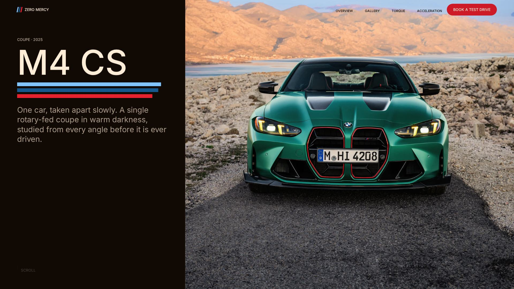
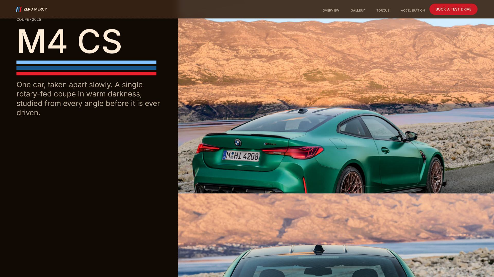
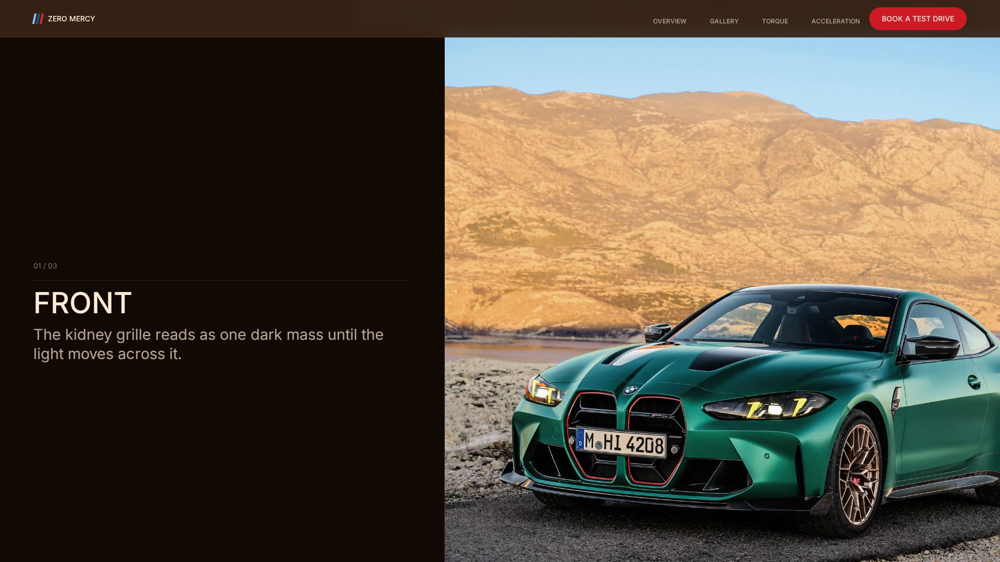
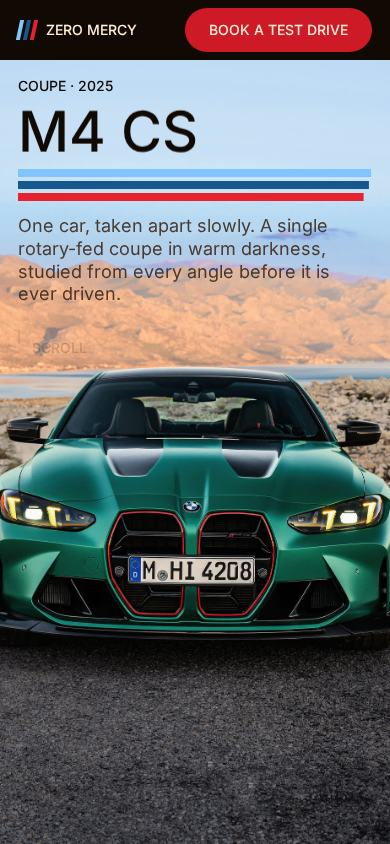

# BMW M4 CS

A scroll-driven, single-car web experience built around the BMW M4 CS — a cinematic
hero, an editorial photo sequence, and motion-led storytelling on one dark canvas.

Not affiliated with, endorsed by, or produced by BMW.

## Overview

This is a premium automotive web experience for one car: the BMW M4 CS. The page
opens on a full-height hero whose photograph sequence advances with the scroll, then
releases into a gallery of three full-bleed statements, two specification sections,
and a closing statement and colophon.

The focus is interaction quality rather than feature count. Everything on the page is
driven by native document scroll — there is no scroll hijacking, no wheel or touch
interception, no `preventDefault`, and no custom scroll engine. The animation layer
is Framer Motion; the styling is plain CSS against a small design-token system.

Copy, specifications, and imagery are centralised in `src/config/content.js` and
`src/data/cars.js`, so no string or figure is hardcoded inside a component.

## Highlights

- **Cinematic hero.** A 200vh section whose type field and media plate both pin for
  the first viewport and release together on the same line, so the composition never
  empties out while the sequence plays.
- **Scroll-driven image sequence.** Five official photographs, four one-way
  transitions, front to rear. Adjacent frames are different camera angles, so each
  pose rides up over the last behind a single hard edge instead of cross-dissolving —
  nothing is ever half-transparent, so there is no double exposure. The whole thing
  is a pure deterministic function of scroll progress: identical forwards and
  backwards, no state, no timers.
- **Native scrolling.** Verified against a real browser: 0 `preventDefault`, 0
  `scrollTo`, 0 wheel/touch interception. Slow, fast, upward and downward scrolling
  all behave like the platform.
- **Responsive layouts.** Checked at 390px, 768px and 1920px with no horizontal
  overflow. The hero switches between an overlaid narrow-screen composition and an
  asymmetric desktop split at 64rem.
- **Framer Motion interactions.** Entrance reveals, the scroll-scrubbed hero orbit,
  and an in-view counter, all animating transform and opacity only.
- **Reduced-motion support.** Under `prefers-reduced-motion` the hero collapses to a
  single viewport, the orbit renders its first pose only, the counter renders its
  final value, and no scroll-triggered content can get stuck hidden.
- **Accessible foundations.** One `h1` and a clean `h2` outline, meaningful alt text
  on content images, decorative layers hidden from assistive technology, a visible
  3px focus ring on every interactive element, and disabled controls that are
  honestly disabled rather than inert anchors.
- **Premium automotive visual direction.** A dark walnut/bark surface stack, one
  typeface, M-stripe accents, dashed hairlines instead of solid rules, and no
  shadows or gradients anywhere.

## Tech Stack

Actual dependencies, from `package.json`:

| | |
| --- | --- |
| React | `19.3.0` |
| React DOM | `19.3.0` |
| Framer Motion | `14.0.0` |
| Inter Variable | `@fontsource-variable/inter` `5.3.0` |
| Vite | `8.3.2` (dev) |
| `@vitejs/plugin-react` | `6.1.1` (dev) |

Styling is hand-written CSS — no CSS framework, no component library, no state
library, no animation library beyond Framer Motion.

## Project Structure

```
index.html            document head — metadata, Open Graph, favicon
public/
  images/             six BMW press photographs used across the page
  favicon.svg, favicon.ico
src/
  sections/           Hero, Gallery, Torque, Acceleration, CallToAction
  components/         Nav, OrbitStack, SiteFooter, Reveal, Counter,
                      CarImage, MStripes, VoidLayout, CarSilhouette
  config/
    content.js        every string on the page
    theme.js          colour, motion and reveal constants
  data/cars.js        the car, its figures, and the image manifest
  hooks/              useNavScrolled
  styles/             tokens, base, components, sections
docs/screenshots/     showcase captures used in this README
```

Editing copy means editing `src/config/content.js`. Editing a figure means editing
`src/data/cars.js`.

## Getting Started

Requires Node `^20.19.0 || >=22.12.0` (the Vite 8 requirement).

```bash
npm install
npm run dev
```

Then open the printed localhost URL.

## Production Build

```bash
npm run build
```

Output is written to `dist/`. To serve the production build locally:

```bash
npm run preview
```

## Browser Support

Verified in Chromium 153 (headless, via Playwright) at 390px, 768px and 1920px.

The implementation relies on baseline features — CSS Grid, `clamp()`,
`position: sticky`, `aspect-ratio`, `backdrop-filter`, variable fonts, and SVG
favicons — so current Chrome, Edge, Firefox and Safari are the intended targets.
Firefox and Safari were **not** exercised in this pass.

## Credits / Assets

- **Photography** — official BMW Group press images of the M4 CS, referenced as
  `press.bmwgroup.com T0441542EN (05/2024)` in `src/data/cars.js`. They are used
  here for a non-commercial design study. No ownership or license over them is
  claimed in this repository; all rights remain with their owner.
- **Figures** — torque and 0–100 km/h are per the same BMW Group PressClub release.
  A known published conflict on the power figures (550 hp global vs 543 hp US) is
  documented in `src/data/cars.js` and deliberately not displayed on the page.
- **Typeface** — Inter Variable, bundled locally through
  `@fontsource-variable/inter` under the SIL Open Font License 1.1.
- **Brand mark** — the three-stripe motif and the wordmark are original to this
  study. The BMW roundel and logo are not reproduced as design elements; they appear
  only where they are part of the photographs.

This is an independent design study. It is not affiliated with, sponsored, or
endorsed by BMW AG.

## Screenshots



*Desktop hero — walnut type field beside the full-bleed media plate.*



*Mid-sequence — one pose rising over the last behind a hard edge.*



*Gallery — the first of three full-bleed statements.*



*Mobile hero — copy over the sky band, car in the lower half.*

## Social Showcase

A scroll-driven single-car experience for the BMW M4 CS: a cinematic pinned hero, a
five-pose photo sequence that advances with the wheel behind a hard edge, and a
responsive dark editorial layout built with React, Framer Motion and plain CSS —
native scrolling throughout, with no scroll hijacking and full reduced-motion
support.
